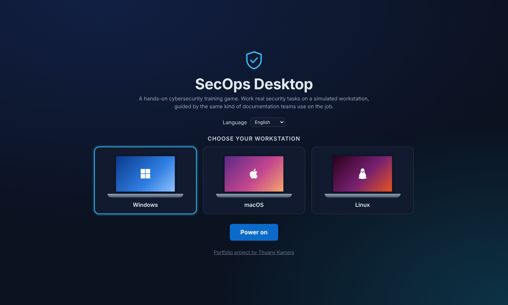
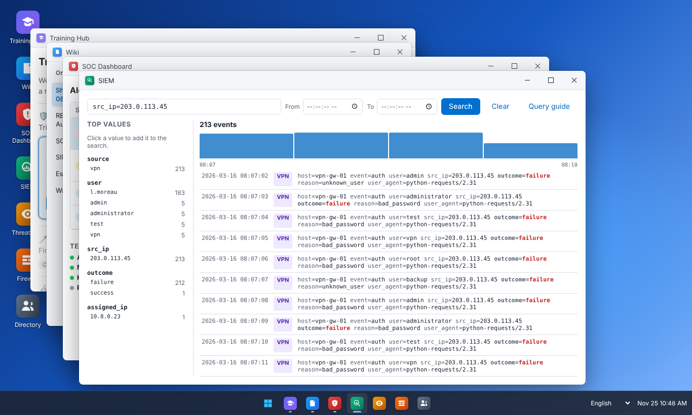
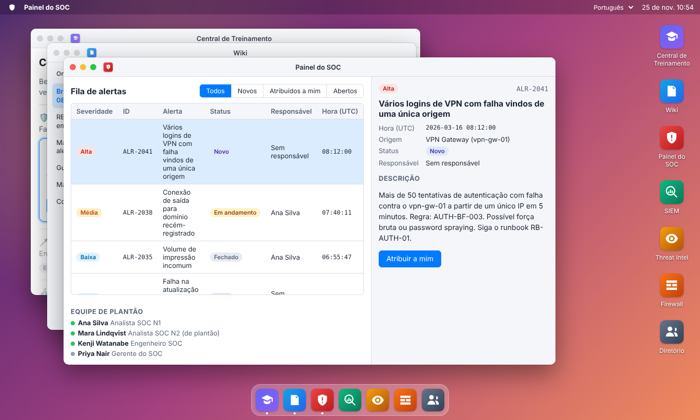
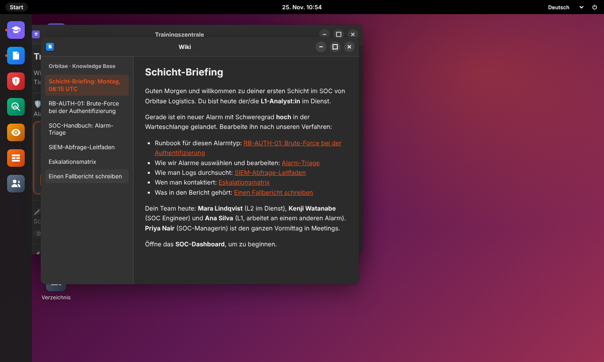
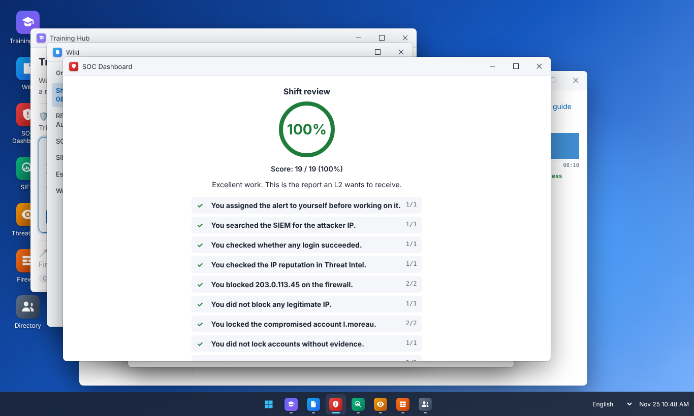

# SecOps Desktop

**A browser-based cybersecurity training game.** Pick a Windows, macOS or Linux workstation, sign in, and work real security tasks with the same kind of tools and documentation a security team uses on the job. No arrows on screen: every mission comes with a ticket, a runbook in the internal Wiki, and a graded case report at the end.

▶ **Play it:** https://thuanykamers.github.io/secops-desktop/

Available in English, Português, Español, Deutsch and Français.



## Mission 1: Knock knock on the VPN (SOC track)

A burst of failed VPN logins triggers a high-severity alert. As the L1 analyst on shift you:

1. Take the alert in the **SOC Dashboard** and set it to *In progress*.
2. Scope the attack in the **SIEM**: 212 failed logins from one IP, password spraying followed by a focused brute force, and **one successful login**.
3. Confirm the source in **Threat Intel** (IP reputation).
4. Follow the compromised session to the finance file server.
5. Contain: block the IP on the **Firewall** and lock the account in the **Directory**.
6. Write a **5 Ws case report**, pick the verdict and escalate to the right person.

The report is graded with specific feedback on what was missed.

| SIEM (Windows) | SOC Dashboard (macOS, Portuguese) |
|---|---|
|  |  |

| Wiki runbooks (Linux, German) | Shift review |
|---|---|
|  |  |

## Skills demonstrated

Alert triage and prioritisation · SIEM investigation and log correlation · IP reputation / threat intelligence · containment (firewall block, account lock) · escalation matrix · incident reporting with the 5 Ws and IOCs.

These are based on my hands-on study notes: [TryHackMe-Studies](https://github.com/ThuanyKamers/TryHackMe-Studies). All scenarios, company names, people, IPs and domains here are fictional (IPs come from the RFC 5737 documentation ranges).

## Roadmap

The game is organised in **tracks** so it can grow beyond the SOC:

- **SOC:** phishing (true and false positives), alert queue prioritisation, data exfiltration and escalation chain, web server log investigation in a Linux terminal, CVE research.
- **Penetration testing**, **digital forensics**, **cloud security**, **GRC**: coming later.

## How it works

- **Stack:** React + TypeScript + Vite, Zustand for state (progress saved in the browser), i18next for translations. Static site deployed to GitHub Pages by GitHub Actions.
- **Missions are data.** Each mission lives in `src/content/missions/<id>/` and declares its alerts, logs, threat intel records, Wiki pages, report fields and grading rules. The desktop and apps are generic and render whatever the active mission provides.
- **SIEM engine:** a small in-memory query language (`field=value`, `AND`/`OR`/`NOT`, wildcards, numeric comparisons, free text, time range) in `src/engine/query.ts`.
- **Tests:** Vitest covers the query engine, the mission's logs and grading, and checks that every language has the same translation keys.

```bash
npm install
npm run dev      # local dev server
npm test         # unit tests
npm run build    # production build in dist/
```

### Adding a mission

1. Create `src/content/missions/<track>-<nn>-<name>/` with `mission.ts` and `locales/{en,pt,es,de,fr}.ts`.
2. Register it in `src/content/index.ts` and its namespace in `src/i18n/index.ts`.
3. Add a test for its grading.

---

Built by [Thuany Kamers](https://github.com/ThuanyKamers).
